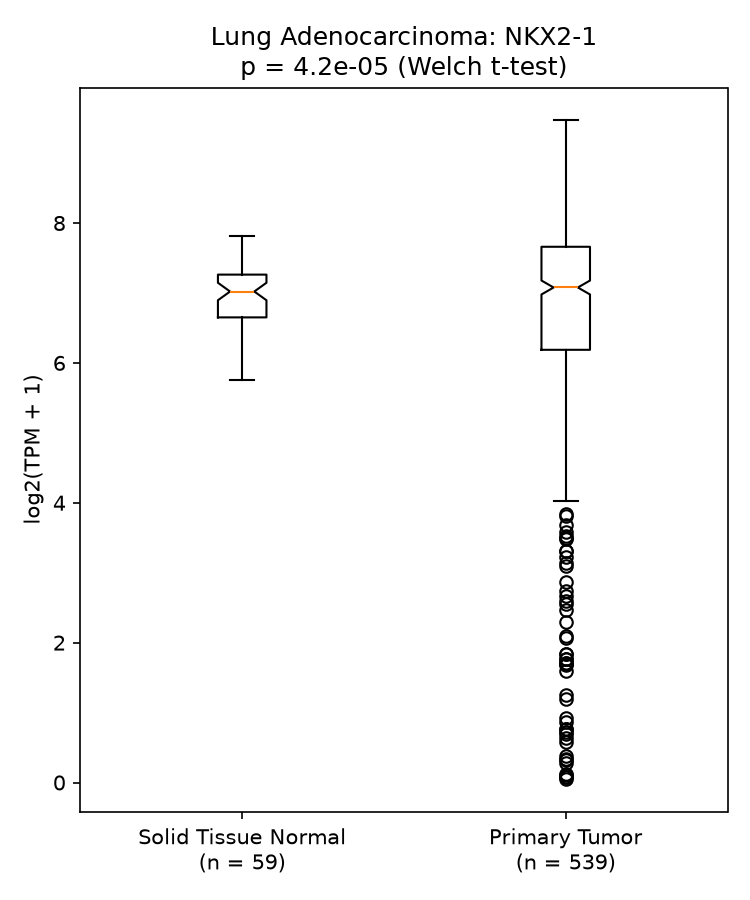

# Project 4: TCGA RNA-seq data analysis (NKX2-1 in Lung Adenocarcinoma)

Compares the expression of the **NKX2-1** gene between **Primary Tumor** and
**Solid Tissue Normal** samples from TCGA-LUAD, and draws a boxplot of log2(TPM + 1).

## Files

- `extract.py`: reads the sample sheet and gets the NKX2-1 TPM value for every tumor and normal sample
- `plot.py`: makes the boxplot and runs the t-test
- `nkx2_1.tsv`: NKX2-1 values made by `extract.py` (File ID, TPM, sample type)
- `NKX2-1_boxplot.png`: the final boxplot

## Input data

From https://figshare.com/s/fd7276e3583b457bd61d:

- `gdc_sample_sheet.tsv`: sample sheet (File ID, File Name, Sample Type, ...)
- `gdc_manifest.txt`: manifest file
- `tcga_data.tar.gz`: gene expression data (not uploaded here because it is large)

## Requirements

Python 3 with `scipy` and `matplotlib`:

```bash
pip3 install scipy matplotlib
```

## How to run

1. Unzip the expression data into a folder called `data`, so each sample is in `data/<File ID>/`:

```bash
mkdir -p data
tar -zxvf tcga_data.tar.gz -C data
```

2. Get NKX2-1 values for all Primary Tumor and Solid Tissue Normal samples:

```bash
python3 extract.py data < gdc_sample_sheet.tsv > nkx2_1.tsv
```

3. Make the boxplot and run the test:

```bash
python3 plot.py < nkx2_1.tsv
```

## How it works

1. `extract.py` reads the sample sheet and keeps only "Primary Tumor" and "Solid Tissue Normal" samples.
2. For each sample it opens `data/<File ID>/<File Name>`, finds the line whose gene name (column 2) is `NKX2-1`, and takes column 7 (`tpm_unstranded`).
3. `plot.py` converts each value to log2(TPM + 1), splits the samples into the two groups, runs a t-test, and draws a notched boxplot with the number of samples (n) and the p-value.

## Check

The PDF hint says sample `e6e83fd4-2f80-44e1-8dce-588a37308dbb` (Solid Tissue Normal) has NKX2-1 TPM = 53.1718:

```bash
grep e6e83fd4-2f80-44e1-8dce-588a37308dbb nkx2_1.tsv
```

Output: `e6e83fd4-2f80-44e1-8dce-588a37308dbb  53.1718  Solid Tissue Normal` ✔

## Result

| Group | n | mean log2(TPM + 1) |
|---|---|---|
| Solid Tissue Normal | 59 | 6.966 |
| Primary Tumor | 539 | 6.556 |

- Welch t-test: p = 4.16e-05
- Student t-test: p = 8.26e-02

The Welch t-test is used on the plot because the two groups have very different sizes
and spread (tumor values vary much more than normal values), and Welch does not assume
equal variance. NKX2-1 expression is significantly lower in Primary Tumor than in
Solid Tissue Normal tissue, and much more variable across tumors.


